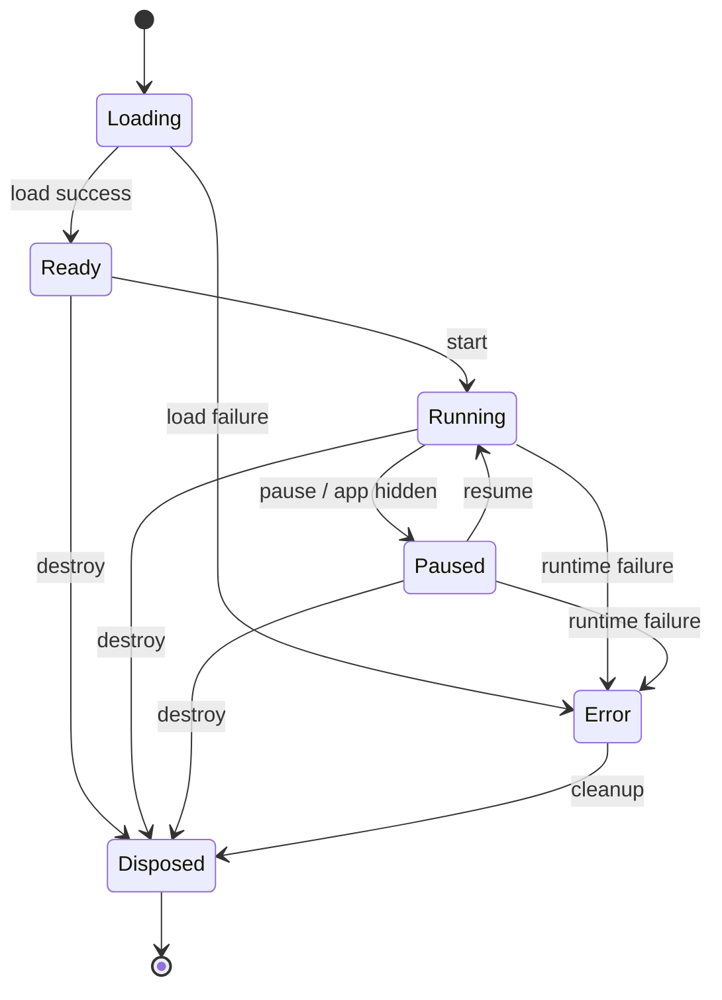

# Game Module Contract

- Status: Proposed contract; must be approved in Phase 01.
- Purpose: make games swappable modules that can be launched and managed consistently.

## Contract goals

Every game must declare its metadata and capabilities, initialize within a host-provided container, accept normalized input, expose supported lifecycle operations, serialize versioned save state where applicable, and clean up resources.

## Conceptual TypeScript interface

This is a design reference, not production code. Refine it during the Phase 01 technical spike.

```ts
export type GameId = string;

export type GameStatus =
  | "ready"
  | "loading"
  | "running"
  | "paused"
  | "error"
  | "disposed";

export interface GameManifest {
  id: GameId;
  title: string;
  version: string;
  description: string;
  genre: string;
  orientation: "any" | "landscape" | "portrait";
  input: {
    keyboard: boolean;
    touch: boolean;
    gamepad: boolean;
  };
  offline: {
    supported: boolean;
    requiredAssets: string[];
  };
  save: {
    supported: boolean;
    schemaVersion: number;
  };
  rightsRecord: string;
}

export interface NormalizedInput {
  type: "key" | "pointer" | "gamepad";
  action: string;
  pressed: boolean;
  timestamp: number;
}

export interface GameHostServices {
  input: {
    subscribe(handler: (event: NormalizedInput) => void): () => void;
  };
  audio: {
    playEffect(id: string): Promise<void>;
    setMuted(muted: boolean): void;
  };
  storage: {
    readSave<T>(gameId: GameId): Promise<T | undefined>;
    writeSave<T>(gameId: GameId, data: T, schemaVersion: number): Promise<void>;
    removeSave(gameId: GameId): Promise<void>;
  };
  lifecycle: {
    requestPause(): void;
    reportStatus(status: GameStatus): void;
  };
}

export interface GameModule {
  load(container: HTMLElement, services: GameHostServices): Promise<void>;
  start(): Promise<void>;
  pause(): Promise<void>;
  resume(): Promise<void>;
  save(): Promise<void>;
  restore(): Promise<void>;
  destroy(): Promise<void>;
}
```

## Contract rules

- `load` must not start gameplay automatically unless the approved design explicitly requires it.
- `start` should be safe to call only from a valid ready/paused state; invalid transitions must be handled predictably.
- `pause` and `resume` must be idempotent where practical.
- `save` must write a versioned game-specific state and handle storage failure.
- `restore` must validate/migrate old state or fail safely without corrupting the existing record.
- `destroy` must stop loops/timers, remove listeners, dispose renderer resources, and release audio resources.
- A game must not directly access another game's save namespace.
- A game must not assume internet connectivity.
- A game must not assume the viewport has a fixed size or aspect ratio.
- Each game must document whether pause, save, restore, touch, controller, and offline are supported.

## Lifecycle state model



## Required per-game test coverage

- manifest validation
- load success/failure
- start/pause/resume transitions
- repeated pause/resume
- resize/orientation handling
- input subscription cleanup
- save/restore and incompatible save version
- storage failure behavior
- offline launch when required assets are present
- failure when required assets are absent
- destroy cleanup and no continuing game loop
