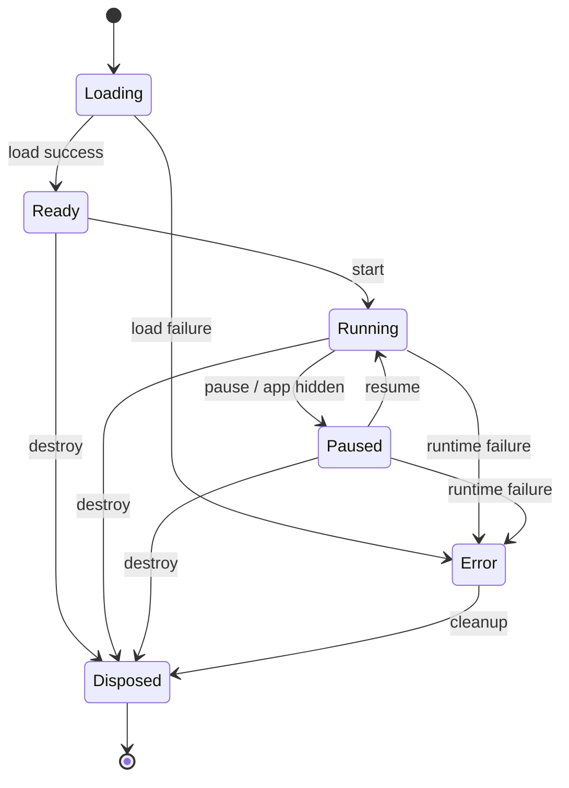

# Game Module Contract (v2)

- Status: Proposed contract; must be approved in Phase 01.
- Purpose: make games swappable modules that can be launched and managed consistently, whether they are native web games or emulator adapters running a user's own disc (SCR-001).
- v2 changes: aligned with manifest version 1; analog input; host-owned audio; versioned blob storage; user-file service; capability report; optional disc-swap and save-state extensions; host pre-launch gating.

## Contract goals

Every game must:
- declare its metadata and capabilities;
- initialize within a host-provided container;
- accept normalized input;
- expose the supported lifecycle operations;
- serialize versioned save state where applicable;
- clean up all resources.

The platform-facing lifecycle (`load`, `start`, `pause`, `resume`, `save`, `restore`, `destroy`) is the same for every runtime adapter (ADR-0002).

## Conceptual TypeScript interface

This is a design reference, not production code. `game-manifest.schema.json` is authoritative for manifests; Phase 02 adds a test that the TypeScript type and the schema agree.

```ts
export type GameId = string;
export type DiscId = string;
export type Platform = "web-native" | "ps1" | "ps2";
export type RuntimeAdapter = "native-canvas" | "wasm-libretro" | "wasm-ps2";
export type BrowserTier = "tier-1" | "tier-2" | "mobile";

/** Availability of a catalogue entry or a linked disc. Shared vocabulary with
 *  OFFLINE_FIRST_DESIGN.md, DATA_MODEL.md and ADR-0003. */
export type AvailabilityState =
  | "NOT_INSTALLED"
  | "DOWNLOADING"
  | "AWAITING_USER_ROM"
  | "NEEDS_PERMISSION"
  | "OFFLINE_READY"
  | "OFFLINE_UNAVAILABLE"
  | "UPDATE_AVAILABLE"
  | "STORAGE_ERROR"
  | "UNSUPPORTED";

/** Runtime lifecycle of a mounted module. */
export type GameStatus = "loading" | "ready" | "running" | "paused" | "error" | "disposed";

export interface GameManifest {
  manifestVersion: 1;
  id: GameId;
  title: string;
  version: string;
  platform: Platform;
  runtimeAdapter: RuntimeAdapter;
  description: string;
  genre: string;
  orientation: "any" | "landscape" | "portrait";
  hardwareRequirements?: {
    requiresSharedArrayBuffer: boolean;
    requiresWebGPU: boolean;
    recommendedRamMB?: number;
    browserTiers: BrowserTier[];
  };
  romConfig?: {
    coreId: string;
    acceptedExtensions: string[];
    biosMode: "required" | "optional" | "none";
    maxDiscs?: number;
    supportsM3uPlaylist?: boolean;
  };
  input: {
    keyboard: boolean;
    touch: boolean;
    gamepad: boolean;
    controllerProfile?: "arcade-4btn" | "dpad-standard" | "ps1-digital-pad" | "ps1-analog-pad" | "ps2-analog-pad";
  };
  offline: {
    supported: boolean;
    contentSource: "bundled" | "user-supplied";
    requiredAssets?: string[];
  };
  save: {
    supported: boolean;
    schemaVersion: number;
    supportsSaveStates?: boolean;
    supportsVirtualMemoryCard?: boolean;
  };
  rightsRecord: string;
  assets: { path: string; required: boolean; mediaType?: string; sha256?: string }[];
  thumbnail?: string;
  releaseStatus?: "idea" | "spec-draft" | "rights-review-required" | "rights-cleared" | "in-development" | "qa" | "accepted" | "retired";
}

/** Logical control names, independent of the physical device (e.g. "dpad-up", "face-south", "start", "stick-left-x"). */
export type ControlId = string;

export type NormalizedInput =
  | { kind: "button"; control: ControlId; pressed: boolean; source: "keyboard" | "pointer" | "gamepad"; timestamp: number }
  | { kind: "axis"; control: ControlId; value: number /* -1..1 */; source: "gamepad" | "pointer"; timestamp: number };

export interface CapabilityReport {
  tier: BrowserTier;
  crossOriginIsolated: boolean;
  sharedArrayBuffer: boolean;
  webgpu: boolean;
  fileSystemAccess: boolean; // showOpenFilePicker + persisted handles
  opfs: boolean;
  persistentStorage: boolean | "unknown";
}

/** Audio owned by the host: one AudioContext per session, unlocked on a user gesture,
 *  suspended on pause / hidden tab, closed on destroy. */
export interface AudioOutput {
  readonly context: AudioContext;
  readonly destination: AudioNode;
}

export interface GameError {
  kind: "load" | "runtime" | "save" | "restore" | "input" | "capability" | "file-access";
  message: string; // user-safe, no file contents or paths
  recoverable: boolean;
}

export interface DiscLinkSummary {
  discId: DiscId;
  label: string; // entered by the user
  state: AvailabilityState;
  storageKind: "fs-handle" | "opfs-copy" | "session-file";
  sizeBytes: number;
}

export interface DiscReader {
  readonly sizeBytes: number;
  /** Read a byte range without loading the whole image into memory. */
  readRange(offset: number, length: number): Promise<Uint8Array>;
  close(): Promise<void>;
}

/** Present only for manifests with offline.contentSource === "user-supplied". */
export interface UserFileService {
  /** Requires a user gesture. Storage kind depends on the browser tier (ADR-0003). */
  linkDisc(options: { acceptedExtensions: string[] }): Promise<DiscLinkSummary>;
  listDiscs(): Promise<DiscLinkSummary[]>;
  getDisc(discId: DiscId): Promise<DiscLinkSummary>;
  /** Re-grant read access for a NEEDS_PERMISSION disc. Requires a user gesture. */
  requestAccess(discId: DiscId): Promise<DiscLinkSummary>;
  openDisc(discId: DiscId): Promise<DiscReader>;
}

export interface GameHostServices {
  readonly capabilities: Readonly<CapabilityReport>;
  input: {
    subscribe(handler: (event: NormalizedInput) => void): () => void;
  };
  audio: {
    playEffect(id: string): Promise<void>;
    setMuted(muted: boolean): void;
    acquireOutput(): Promise<AudioOutput>;
  };
  storage: {
    readSave<T>(gameId: GameId): Promise<T | undefined>;
    writeSave<T>(gameId: GameId, data: T, schemaVersion: number): Promise<void>;
    removeSave(gameId: GameId): Promise<void>;
    /** Binary records such as memory cards and save states, namespaced by game and key
     *  (e.g. "disc/<discId>/memcard/1", "disc/<discId>/state/3"). */
    blobs: {
      read(gameId: GameId, key: string): Promise<{ data: Uint8Array; schemaVersion: number } | undefined>;
      write(gameId: GameId, key: string, data: Uint8Array, schemaVersion: number): Promise<void>;
      remove(gameId: GameId, key: string): Promise<void>;
      list(gameId: GameId, prefix?: string): Promise<string[]>;
    };
  };
  files?: UserFileService;
  lifecycle: {
    requestPause(): void;
    reportStatus(status: GameStatus): void;
    reportError(error: GameError): void;
  };
}

export interface GameModule {
  load(container: HTMLElement, services: GameHostServices): Promise<void>;
  start(): Promise<void>;
  pause(): Promise<void>;
  resume(): Promise<void>;
  save(): Promise<void>;
  restore(): Promise<void>;
  destroy(): Promise<void>;
}

/** Optional extensions, detected with type guards. */
export interface DiscSwappable {
  listDiscSlots(): readonly { index: number; label: string }[];
  swapDisc(index: number): Promise<void>;
}
export interface SaveStateCapable {
  saveState(slot: number): Promise<void>;
  loadState(slot: number): Promise<void>;
}
export const isDiscSwappable = (m: GameModule): m is GameModule & DiscSwappable => "swapDisc" in m;
export const isSaveStateCapable = (m: GameModule): m is GameModule & SaveStateCapable => "saveState" in m;
```

## Host responsibilities before launch

The host, not the module, decides whether a launch may start:

1. Validate the manifest against the schema; reject unsupported `manifestVersion`.
2. Build the `CapabilityReport`; if the entry's `browserTiers` or requirements are not met, the entry is `UNSUPPORTED` and the module is never loaded (FR-019, Flow J).
3. For user-supplied content, resolve the disc's `AvailabilityState`. `AWAITING_USER_ROM` starts Flow F; `NEEDS_PERMISSION` asks for the re-grant first (Flow G). The module is loaded only for a disc that is `OFFLINE_READY` or available online.
4. Unlock audio on the launching user gesture.

## Contract rules

- `load` must not start gameplay automatically unless the approved design explicitly requires it.
- `start` should be safe to call only from a valid ready/paused state; invalid transitions must be handled predictably.
- `pause` and `resume` must be idempotent where practical. The host also pauses on hidden tab and focus loss.
- `save` must write a versioned game-specific state and handle storage failure.
- `restore` must validate/migrate old state or fail safely without corrupting the existing record. Save states are also tied to the core version; an incompatible core version is rejected, not loaded.
- `destroy` must:
  - stop loops and timers, and remove listeners;
  - dispose renderer resources;
  - release audio (disconnect nodes, stop worklets);
  - close `DiscReader`s;
  - for emulator adapters, terminate workers and remove the iframe.
- A game must not directly access another game's save namespace.
- A game must not assume internet connectivity.
- A game must not assume the viewport has a fixed size or aspect ratio.
- A game must not send user files, BIOS data, or saves over the network (FR-027).
- Emulator adapters run in a same-origin iframe and communicate with the host only through a typed message protocol (ADR-0002). The host-side adapter object implements `GameModule`.
- Each game must document whether pause, save, restore, touch, controller, and offline are supported.

## Lifecycle state model



Availability (`AvailabilityState`) is evaluated by the host before `Loading`; it is not part of this runtime state machine.

## Required per-game test coverage

- manifest validation
- load success/failure
- start/pause/resume transitions
- repeated pause/resume
- resize/orientation handling
- input subscription cleanup
- save/restore and incompatible save version
- storage failure behavior
- offline launch when required assets are present
- failure when required assets are absent
- destroy cleanup and no continuing game loop

Additional coverage for emulator adapters:

- capability gating (`UNSUPPORTED` entries never load)
- `AWAITING_USER_ROM` and `NEEDS_PERMISSION` launch paths
- `DiscReader.readRange` reads ranges without loading the whole file
- memory-card and save-state round trip; save state from a different core version rejected
- disc swap (if `DiscSwappable`)
- iframe and worker removal on `destroy` (no remaining audio or timers)
- no network request carries user data
