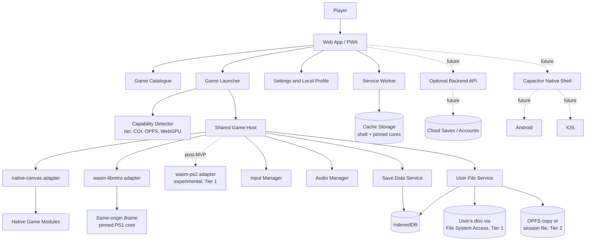

# System Overview

- Status: Proposed architecture for Phase 01 review
- Scope: Browser-first single-player MVP, offline-ready, mobile-expandable; native games plus a generic BYOR PS1 player (SCR-001); PS2 experimental, post-MVP

## Context

The product has a platform shell (catalogue, navigation, settings, offline status) and multiple independent games. The platform should own shared concerns while each game owns its own rules, rendering, and game-specific state.

## High-level architecture

## Responsibilities

### Web application shell

Owns navigation, catalogue views, preferences, connection state, accessibility shell, and the game-player container.

### Catalogue and game registry

Loads validated metadata and determines whether a game is enabled, supported, rights-cleared, and available offline.

### Game launcher / host

Creates the game environment, injects approved platform services, handles lifecycle, catches/report errors, and cleans up resources when a game closes.

### Game modules and runtime adapters

Native game modules own game rules, rendering, game-specific assets, state transitions, and their own unit tests. They must not manipulate unrelated platform UI directly.

Emulator adapters (ADR-0002) implement the same `GameModule` contract on the host side and run the pinned emulator core in a same-origin iframe, connected by a typed message protocol. The adapter never receives raw file handles; it reads disc data through the host's User File Service.

### User File Service

Links the user's own disc images and BIOS files, persists handles or OPFS copies according to the browser tier (ADR-0003), reports `NEEDS_PERMISSION`, and provides range reads. It never uploads anything.

### Shared platform services

Provide input abstraction, audio lifecycle, local save operations, offline package status, and diagnostics through typed interfaces.

### Offline layer

Uses a service worker and Cache Storage for application/game assets, and IndexedDB for structured metadata, preferences, and save data. Exact implementation is subject to ADR approval.

### Optional future backend

May later support accounts, remote saves, leaderboards, or multiplayer. It is not required for the MVP and must not be introduced by assumption.

## Key architecture constraints

- No arbitrary execution of remote JavaScript game bundles. Emulator cores are self-hosted, pinned to an exact version, and verified by SHA-256; they are never loaded from a third-party CDN at runtime.
- The app is cross-origin isolated (COOP/COEP/CORP) in every environment, including when served offline by the service worker.
- A game must be loaded from the trusted application build or a separately reviewed and integrity-checked package mechanism approved by ADR.
- Games must declare capabilities and required assets.
- The platform must not call a game offline-ready until all required files are available locally.
- Saves must be namespaced by game ID and schema version.
- A game must release timers, listeners, audio nodes, and rendering resources when destroyed.
- Shared services must be testable independently of the visual UI.

## Future architecture evolution

The initial architecture should leave seams for backend services and mobile adapters without implementing them prematurely. Any move to remote distribution, accounts, multiplayer, or server-side services requires its own requirements and ADR.
