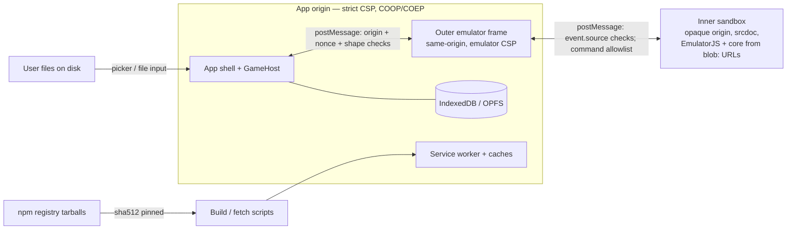

# Threat Model — Retro Arcade draft v0.1

- Status: Draft for owner review (DEC-003 draft-first mode). Study/research project; not for commercial use.
- Scope: the browser app on branch `draft/v0.1-first-build` — the shell, Comet Courier, the BYOR PS1 player, the service worker, and the build/fetch scripts.
- Method: STRIDE per trust boundary. Every mitigation listed as "verified" has an automated test or a recorded spike measurement. Everything else is design-only.

## 1. Assets

| Asset | Why it matters |
|---|---|
| User disc images (via handles, OPFS copies, or session files) | User property and personal library; large; must never leave the device (FR-027) |
| User BIOS file | Copyrighted firmware supplied by the user; must never leave the device or appear in exports |
| Memory cards, save states, game saves | User progress; integrity and availability matter |
| Persisted file handles | Grant read access to files on the user's disk |
| App code, emulator core, service-worker caches | Integrity: whatever is cached runs offline indefinitely |
| User's other browsing (other origins) | Must not be exposed through this app (clickjacking, leaks) |

## 2. Trust boundaries

- **B1 — User files → app.** Untrusted content: disc images, cue sheets, playlists, BIOS files, imported backups.
- **B2 — App shell ↔ outer emulator frame.** Same origin, separate document with a relaxed CSP.
- **B3 — Outer frame ↔ inner sandbox.** The inner frame runs third-party GPL code (EmulatorJS) over untrusted disc data, with an opaque origin.
- **B4 — Supply chain.** npm packages, the EmulatorJS tarballs, and test fixtures.
- **B5 — Network/hosting.** Static host, headers, service worker, offline cache.

## 3. Threats and mitigations

| # | Threat (STRIDE) | Boundary | Mitigation | Status |
|---|---|---|---|---|
| T1 | A malicious disc image exploits a bug in the emulator core or EmulatorJS (E: elevation) to run script with app privileges | B3 | Core runs inside a **sandboxed srcdoc iframe without `allow-same-origin`**, so it has an opaque origin with no access to the app's DOM, IndexedDB, OPFS, saves, or file handles. WASM memory-safety is the first layer; the sandbox is the second | **Verified** (e2e): inner `origin` is `null`; parent DOM, `top.location` and IndexedDB blocked |
| T2 | Compromised emulator code exfiltrates the disc, BIOS or saves (I: information disclosure) | B3, B5 | Frame CSP `connect-src 'self' blob:`, `img-src 'self' data: blob:`, `form-action 'none'`, `default-src 'self'` — no route to another origin. The sandbox has no `allow-top-navigation` or `allow-popups` | **Verified** (e2e): `fetch('https://example.com')` from the sandbox is blocked. EmulatorJS's update check and CDN core fallback are blocked (SPIKE-001) |
| T3 | Forged or injected messages to the host (S: spoofing, T: tampering) | B2 | Host accepts only `event.source === our iframe`, `event.origin === location.origin`, a per-session 128-bit nonce, and validated shapes and sizes (`parseFrameMessage`); unknown types are dropped | **Verified** (unit): wrong nonce, version, type, shape or size → dropped |
| T4 | Messages from the inner sandbox abuse the outer frame | B3 | Outer frame accepts inner messages only by `event.source`, forwards only `started/save/state/error`, and forwards only an allowlist of commands inward; the host re-validates everything | Design + unit (host side) |
| T5 | `postMessage(…, '*')` leaks data to another window | B3 | Used only on the sandbox edge, where an opaque origin cannot be named. Recipients are fixed: the outer's own child element and the inner's own parent; navigation of either destroys the pair | Design (documented) |
| T6 | XSS in the shell through file names, disc labels, cue/playlist contents or backup data (T/E) | B1 | React text rendering only (no `dangerouslySetInnerHTML`/`innerHTML` in app code — scanned); labels normalised and allow-listed; shell CSP `script-src 'self'` with no `unsafe-*`; routes parsed by strict patterns | **Verified** (unit: label sanitizer, router; e2e: no CSP violations on the shell) |
| T7 | Path traversal or unexpected files via `.m3u`/`.cue` references | B1 | Entries must be bare file names the user selected; URLs, absolute paths, `..`, separators, and unreferenced extras rejected; sheet size ≤ 64 KiB; ≤ 16 files | **Verified** (unit) |
| T8 | Malicious save-backup zip: zip bombs, traversal names, oversize entries, CRC forgery, unknown games, poisoned keys (T/D) | B1 | Reader accepts stored entries only; limits on count, entry size and total size; strict names; CRC check; `backup.json` index with SHA-256 per entry; known game IDs and safe storage keys only; nothing written until the whole archive validates; BIOS and discs are never part of backups | **Verified** (unit) |
| T9 | Malicious or wrong BIOS file (T) | B1 | `.bin` only, size 64 KiB–4 MiB, hashed locally, only ever handed to the sandbox | Design + code |
| T10 | Supply-chain compromise of npm dependencies (T/E) | B4 | 9 direct dev deps + 2 runtime deps, exact versions, lockfile, `--ignore-scripts` (no install scripts exist), `npm audit` clean, permissive licences | **Verified** (audit 0 vulns on 2026-11-22) |
| T11 | Tampered or substituted EmulatorJS/core download (T/E) | B4 | Fetched as tarballs pinned by `sha512` integrity; extraction into a fresh temp dir with traversal check; file allowlist (no RAR extractor, no threaded or other cores); never `npm install` (unpinned `latest` deps) | **Verified** (fetch script) |
| T12 | Emulator CDN fallback or update check reaches third parties | B5 | `connect-src 'self' blob:` in the frame; cores are always shipped locally | **Verified** (SPIKE-001) |
| T13 | Clickjacking / framing of the app (S/T) | B5 | Shell `frame-ancestors 'none'`; emulator frame `frame-ancestors 'self'`; frame refuses to run without a valid nonce and parent | **Verified** (e2e: frame refuses to run standalone) |
| T14 | Cross-window attacks, Spectre-class side channels (I) | B5 | COOP `same-origin`, COEP `require-corp`, CORP `same-origin` on every response | **Verified** (e2e headers; SPIKE-001 A1/A2) |
| T15 | Stale or poisoned offline cache (T/D) | B5 | Same-origin GET only, no Range requests, versioned shell caches, explicit user-applied updates, emulator package installed atomically (old cache removed only after the new one completes) | **Verified** (e2e offline) for the shell; update flow design-only |
| T16 | Unneeded powerful browser features abused (E) | B5 | Permissions-Policy disables camera, mic, geolocation, payment, USB, serial, HID, Bluetooth, MIDI, display-capture; gamepad/fullscreen limited to self; only the emulator frame delegates gamepad, fullscreen and screen-wake-lock to its sandbox | Header verified (unit) |
| T17 | Persisted file handles reused without consent (E/I) | B1 | Read-only permission only; browser re-prompts after restart (`NEEDS_PERMISSION`); handles are never sent to the emulator — only `File` contents for the session | Design + code |
| T18 | Data loss: eviction, quota, browser data clearing (D) | B5 | `persist()` requested after meaningful actions; quota check before OPFS copy with session fallback; save export (Must on Tier 2); clear warnings | Partly verified (OPFS copy survives restart in Chrome — SPIKE-001) |
| T19 | Denial of service from huge discs (D) | B1 | EmulatorJS loads whole files (memory ≈ disc size); single PS1 discs fit on desktop; mobile is excluded | Measured (SPIKE-001 A4) |
| T20 | Privacy leaks: telemetry, referrers, disc names in logs (I) | B5 | No analytics; `Referrer-Policy: no-referrer`; diagnostics never include file names, labels, or fingerprints; disc fingerprint is local-only | Design |
| T21 | Tampered or corrupted board-game saves (e.g. edited IndexedDB, or an imported backup) crash the game or inject markup (T/D) | B1 | Saves are validated structurally per game (`validate*State`) and discarded on failure (new game); board text is set with `textContent`, never HTML; imported backups pass the T8 checks first | **Verified** (unit: tampered states rejected) |
| T22 | AI worker returns a malformed or illegal move, or a stale one after undo/new game (T) | B2 | Worker validates request shape; every reply carries a request id and stale replies are dropped; the game accepts a reply only if it matches one of its own legal moves | Design + e2e (computer replies) |

## 4. Residual risks (accepted for the draft, owner to confirm)

- **R-A: Emulator frame needs `'unsafe-eval'` and `blob:` scripts (DEC-004).** Contained by the sandbox and connect-src. Removing it would require changing how EmulatorJS loads cores.
- **R-B: Inline styles allowed in the emulator frame only.** Style injection inside the sandbox cannot reach the app.
- **R-C: The outer emulator frame is same-origin.** It is required so the service worker can serve it offline. Its code is small and first-party, and it never evaluates data. A bug in it would have app-origin privileges.
- **R-D: Same-origin `postMessage('*')` on the sandbox edge** (T5).
- **R-E: `Vary` is ignored in cache matching.** Safe for static assets only; the service worker never caches dynamic or user data.
- **R-F: GPL-2.0 status of the PS1 core** (licence, not security) — see ADR-0001.

## 5. Gaps to close later

- Real-browser verification on Safari and Firefox (Tier 2), including sandbox and storage behaviour. Automated runs used Chrome only.
- A real-browser check of the Tier 1 File System Access picker and permission prompts (manual checklist in SPIKE-001).
- `_headers` behaviour on the chosen host (preview deploy) before any public release.
- Fuzzing the zip reader and playlist/cue parsers beyond the unit cases.
- Subresource Integrity is not used for same-origin assets. Integrity relies on same-origin delivery plus the service-worker version; consider SRI if a CDN is ever introduced.
- An independent security review before any public release.
